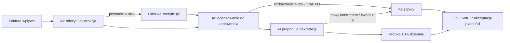

# Etap 3 · 70 min · Człowiek + AI: co zostawisz człowiekowi?

**Cel:** 3 procesy do pierwszej fali, 1 proces świadomie zostawiony człowiekowi, mapa HITL i payback w miesiącach.
**Reguła wyboru:** 2 procesy z szybkim efektem + 1 proces bezpośrednio wspierający priorytet z Etapu 2.

**Excel:** `E3_Scoring`, `E3_HITL`, `E3_Business_case`. **Kalkulator:** `python3 narzedzia/kalkulator.py payback …`

**Czaty Claude (min 15–50):** `analityk-operacji`: scoring procesów · `analityk-finansowy`: business case · `ekspert-prawny`: ryzyka procesów → `weryfikator` + przeliczenie w Excelu.

## Część I — scoring (min 0–30)

Każdy proces z kart źródłowych oceńcie w skali **1–5** (1 = bardzo nisko, 5 = bardzo wysoko). Potencjał i ryzyko to średnie z kolumn.

**Potencjał AI**

| Proces | Wolumen | Powtarzalność | Ustrukturyzowanie danych | Pracochłonność (FTE) | Poziom błędów | **Potencjał śr.** |
|---|---|---|---|---|---|---|
| [proces 1] | | | | | | |
| [proces 2] | | | | | | |
| … | | | | | | |

**Ryzyko błędu**

| Proces | Wpływ błędu na klienta / SLA | Dane osobowe | Regulacje | Nieodwracalność decyzji | Potrzeba empatii / osądu | **Ryzyko śr.** |
|---|---|---|---|---|---|---|
| [proces 1] | | | | | | |
| [proces 2] | | | | | | |
| … | | | | | | |

Granica ćwiartek = **3,0** `[ZAŁOŻENIE]` — przy dużym skupieniu wyników użyjcie mediany.

## Macierz potencjał AI × ryzyko błędu

```
 Potencjał AI
   wysoki │ ① PIERWSZA FALA: automatyzuj      │ ② AI wspiera, człowiek zatwierdza
          │   AI wykonuje, człowiek kontroluje │   mapa HITL z progiem eskalacji
          │   próbkę; szybkie efekty, FTE      │   często proces z priorytetu E2
   ───────┼────────────────────────────────────┼──────────────────────────────────
    niski │ ③ Usprawnienia bez AI              │ ④ ZOSTAW CZŁOWIEKOWI
          │   standaryzacja, szablony, makra   │   relacje z klientem, decyzje kadrowe
          │   nie zużywa budżetu 1. fali       │   AI Act: AI w HR = wyższe ryzyko
          └────────────── niskie ──────────────┴──────────── wysokie ──── Ryzyko błędu
```

Wybieracie **2 procesy z ćwiartki ①**, **1 z ćwiartki ②** (powiązany z E2) i **1 z ćwiartki ④** jako „zostawiony człowiekowi”. Uzasadnienie tego ostatniego to gotowa odpowiedź na pytanie jury o etykę i AI Act.

## Część II — projekt procesu (min 30–60)

**Proces obecny** (z karty źródłowej):

| Krok | Kto | Czas (min) | Narzędzie | Typowe błędy |
|---|---|---|---|---|
| 1 | | | | |
| 2 | | | | |
| … | | | | |

**Mapa HITL** — przykład ilustracyjny (faktury kosztowe), progi `[ZAŁOŻENIE]` do kalibracji na danych:

| Krok | Wykonawca | Punkt kontroli | Próg eskalacji do człowieka | Właściciel |
|---|---|---|---|---|
| Odczyt i ekstrakcja danych z faktury | AI | Walidacja pól obowiązkowych | Pewność odczytu < 90% | Lider zespołu AP |
| Dopasowanie do zamówienia | AI | Porównanie kwot | Rozbieżność > 2% lub brak zamówienia | Księgowy |
| Dekretacja | AI proponuje | Próbka 10% sprawdzana dziennie | Nowy kontrahent, kwota > [X] zł | Księgowy |
| Akceptacja płatności | **Człowiek** | Zawsze | — | Kierownik działu |
| Raport błędów AI | AI + człowiek | Przegląd tygodniowy | Wzrost błędów > 1 pp | Ambasador AI |

Diagram (Mermaid — wkleić do mermaid.live lub poprosić Claude o wersję dla procesu):



## Część III — mini business case (min 60–70)

| Pozycja | Wzór | Wartość |
|---|---|---|
| Liczba użytkowników (n) | z mapy HITL | |
| Cena licencji / użytkownik / mies. (c) | z Excela lub od mentora | |
| Koszt licencji / mies. | n × c | |
| Wdrożenie i integracja (jednorazowo) | z Excela / `[ZAŁOŻENIE]` | |
| Szkolenia (jednorazowo) | osoby × godziny × koszt godziny | |
| Godziny zaoszczędzone / mies. (h) | z karty procesu: kroki AI × wolumen | |
| Oszczędność FTE | h / 160 | |
| Wartość uwolnionego czasu / mies. | FTE × mies. koszt etatu | |
| **Payback prosty (mies.)** | koszt całkowity / oszczędność mies. | |
| **Payback netto (mies.)** | koszt jednorazowy / (oszczędność mies. − licencja mies.) | |
| Test wrażliwości | payback przy oszczędności −30% | |

**Pokazujcie payback netto** — uwzględnia stały koszt licencji i jury rzadziej go podważa.

## Wynik etapu

| | Proces | Ćwiartka | Potencjał | Ryzyko | FTE uwolnione | Uzasadnienie |
|---|---|---|---|---|---|---|
| Fala 1 — szybki efekt | | ① | | | | |
| Fala 1 — szybki efekt | | ① | | | | |
| Fala 1 — wspiera priorytet E2 | | ② | | | | |
| **Zostawiony człowiekowi** | | ④ | | | — | |

**Payback netto:** … mies. (przy −30% oszczędności: … mies.)

---

### ✅ DECYZJA DO PODJĘCIA PRZEZ ZESPÓŁ
3 procesy pierwszej fali, 1 proces zostawiony człowiekowi i progi eskalacji w mapie HITL → wpis E3 w [`rejestr-decyzji.md`](../rejestr-decyzji.md).
